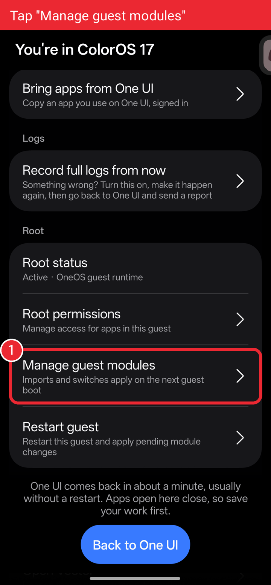
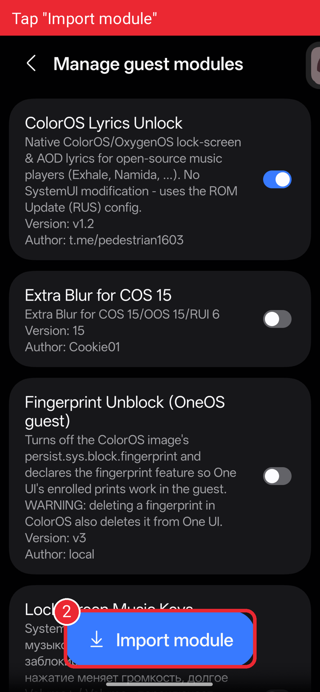
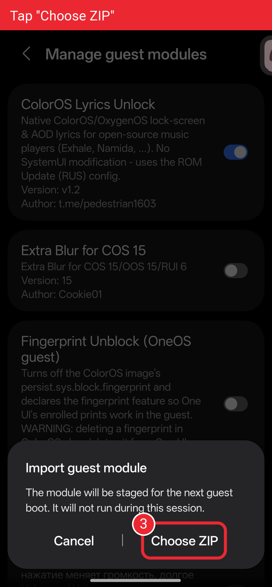
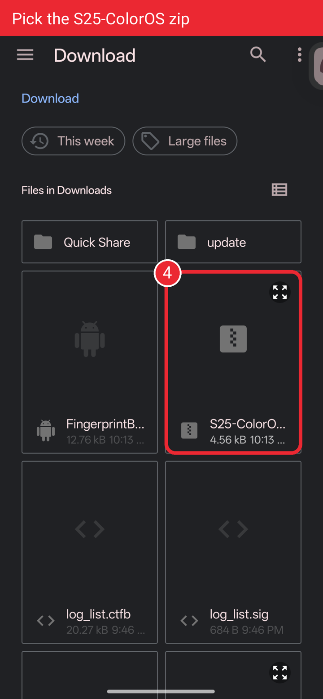
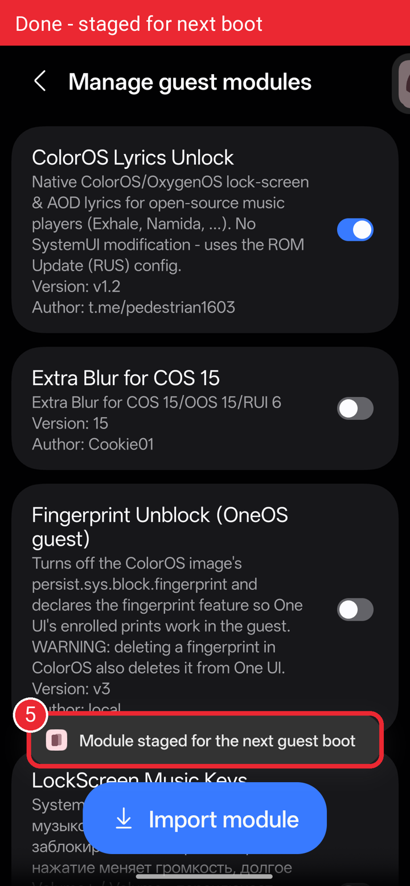
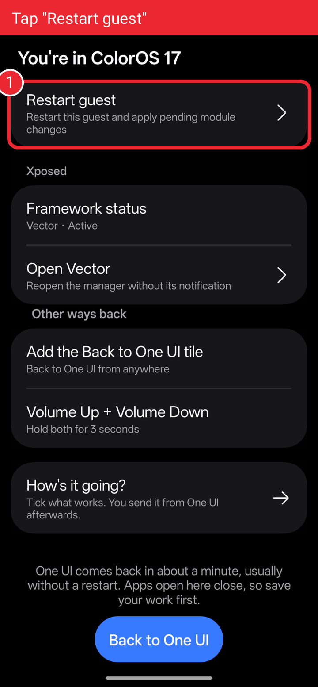
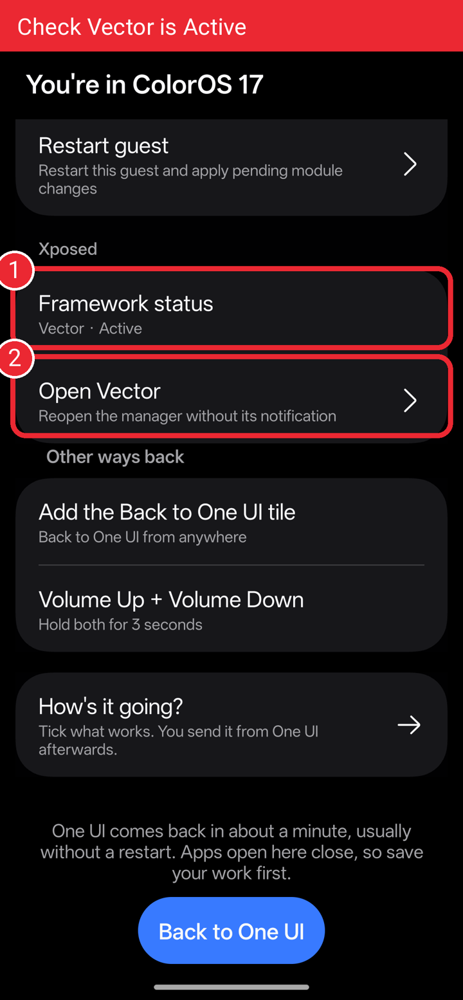
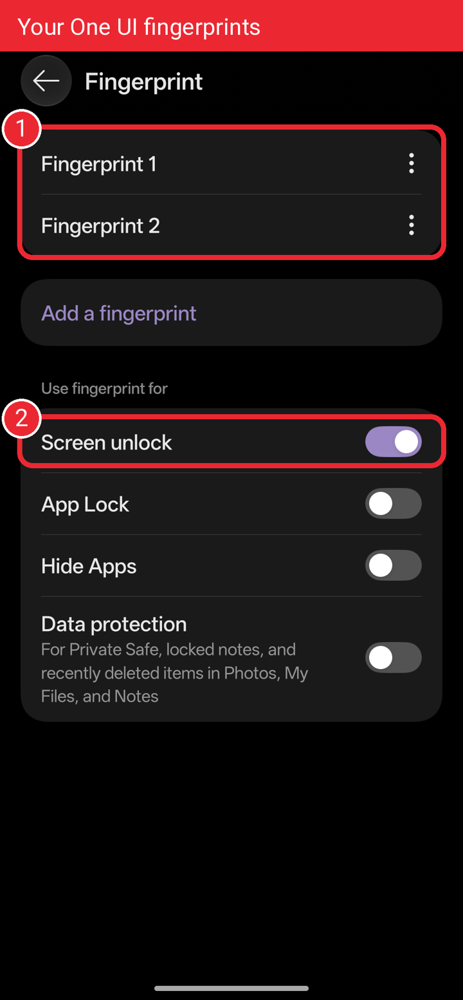

# S25 ColorOS Fingerprint Bridge

Fingerprint unlock for the **ColorOS 17 guest system in OneOS** on the **Samsung Galaxy S25 series**.

Out of the box ColorOS on a Galaxy has no fingerprint at all. With this:

- ✅ Unlock with your fingerprint on the lock screen **and straight from AOD**
- ✅ The ColorOS 17 fingerprint **ring**, placed exactly over your sensor
- ✅ The ColorOS **pressed animation** (the smooth 50 fps version)
- ✅ Fingerprint shows up in **Settings → Password & security → Fingerprint** (App Lock, Hide Apps, etc. work too)
- ✅ Uses the fingerprints you already set up in **One UI** — nothing to re-enroll
- ✅ Stays working after every **Restart guest**

> Tested on a Galaxy S25 (SM-S931B) with ColorOS 17 in OneOS. S25+ and S25 Ultra should work (the ring position is measured on your phone), but are untested — please open an issue and tell me how it goes.

---

## What you need

| | |
|---|---|
| Phone | Galaxy S25 / S25+ / S25 Ultra, rooted (KernelSU) |
| Guest | ColorOS 17 running in OneOS, with guest root on |
| Xposed | **Vector** (recommended) or LSPosed selected as the guest's Xposed framework |
| Fingerprints | At least one fingerprint added in **One UI** (Samsung) settings |
| Lock | A PIN / password set in ColorOS (fingerprint unlock needs one) |

## Download

Get both files from the [**latest release**](../../releases/latest):

- `S25-ColorOS-Fingerprint-v1.1.zip` — the module
- `FingerprintBridge.apk` — the Xposed part

---

## Install (5 minutes)

Do all of this **inside ColorOS**.

### 1. Install the module

Open the **OneOS** app (the *"You're in ColorOS 17"* screen) and:

1. Tap **Manage guest modules**
2. Tap **Import module**
3. Tap **Choose ZIP**
4. Open **Download** and pick `S25-ColorOS-Fingerprint-v1.1.zip`
5. It says *"Module staged for the next guest boot"* — done

| 1 | 2 | 3 |
|---|---|---|
|  |  |  |

| 4 | 5 |
|---|---|
|  |  |

### 2. Install the app

Open `FingerprintBridge.apk` from your Downloads and tap **Install**.

### 3. Turn it on in Vector

- **Vector:** nothing to do — the module turns *Fingerprint Bridge* on for you (scope *System Framework*) on the first boot. You can check it in step 5.
- **LSPosed:** open LSPosed → **Modules** → **Fingerprint Bridge** → switch it **on** → tick **System Framework**.

### 4. Restart the guest

In the OneOS app, tap **Restart guest**.

> On the **first** boot the module measures where the sensor is on *your* phone. Tap **Restart guest one more time** so the ring moves to the right spot.

### 5. Check it works

1. In the OneOS app, **Framework status** should say **Vector · Active** (tap **Open Vector** to see *Fingerprint Bridge* is on).

   

2. Open **Settings → Password & security → Fingerprint**. Your One UI fingerprints are listed (1) and **Screen unlock** is on (2).

   

3. Lock the phone: the ring sits over the sensor. Put your finger on it — the animation plays and the phone unlocks. Also try from **AOD** without waking the screen first.

   

---

## ⚠️ Important

- **Add / remove fingerprints in One UI only.** ColorOS's *Add a fingerprint* button does not work (ColorOS can't talk to the phone's secure chip to enroll). New One UI fingerprints show up in ColorOS after the next *Restart guest*.
- **Never tap Delete on a fingerprint in ColorOS.** It deletes it from the secure chip, so it is **gone from One UI too**.
- Your fingerprints never leave the phone's secure chip. Only their names/IDs are copied into ColorOS.

## Troubleshooting

| Problem | Fix |
|---|---|
| No fingerprint in Settings | Add a fingerprint in One UI first, then *Restart guest*. |
| Ring in the wrong place | *Restart guest* once more (the position is measured on the first boot). |
| No animation / no unlock from AOD | Check *Fingerprint Bridge* is on in Vector/LSPosed with scope *System Framework*, then *Restart guest*. |
| Something else | Send `/data/adb/modules/s25_coloros_fingerprint/log.txt` in an issue. |

## Uninstall

OneOS app → **Guest modules** → remove *S25 ColorOS Fingerprint*, uninstall *Fingerprint Bridge*, then **Restart guest**.

---

## How it works (for the curious)

ColorOS is built for OPPO hardware, so on a Galaxy several things are missing. The module fixes them one by one:

| Problem on a Galaxy | Fix |
|---|---|
| The ColorOS image blocks fingerprint (`persist.sys.block.fingerprint=true`) | set to `false` |
| ColorOS hard-codes OPPO's old HIDL fingerprint driver (`"0:2:15"`) unless `vendor.fingerprint.aidl.support=1` | set it, so ColorOS uses Samsung's AIDL driver |
| No fingerprint list in ColorOS | One UI's list is copied in before ColorOS starts |
| Missing `/data/vendor_de/0/fpdata` folder | created at boot |
| No ring / effect (`sensor_type` unknown) | `persist.vendor.fingerprint.sensor_type=ultrasonic` + ring size/position measured from `/sys/class/fingerprint/fingerprint/position` |
| ColorOS waits for OPPO's "finger down" signal (`onFingerprintCmd 1201/1202`), Samsung sends its own (`vendorCode 10002 / 10014`) | **Fingerprint Bridge** (Xposed, `system_server`) translates one into the other |
| Fingerprint stops on AOD | turns on ColorOS's hidden *show fingerprint when screen off* setting |
| 30 fps pressed animation | `debug.systemui.gaussblur_level=1` → the 50 fps version (keeps the clock's unlock animation) |

Everything is undone when the module is removed. Every hook catches its own errors, so a failure can only mean "no animation", never a crash back to One UI.

## Build it yourself

On the phone in Termux (root needed): `pkg install openjdk-21 d8 aapt2 apksigner python`, then `./build-release.sh`. Output goes to `release/`.

## License

MIT
